

  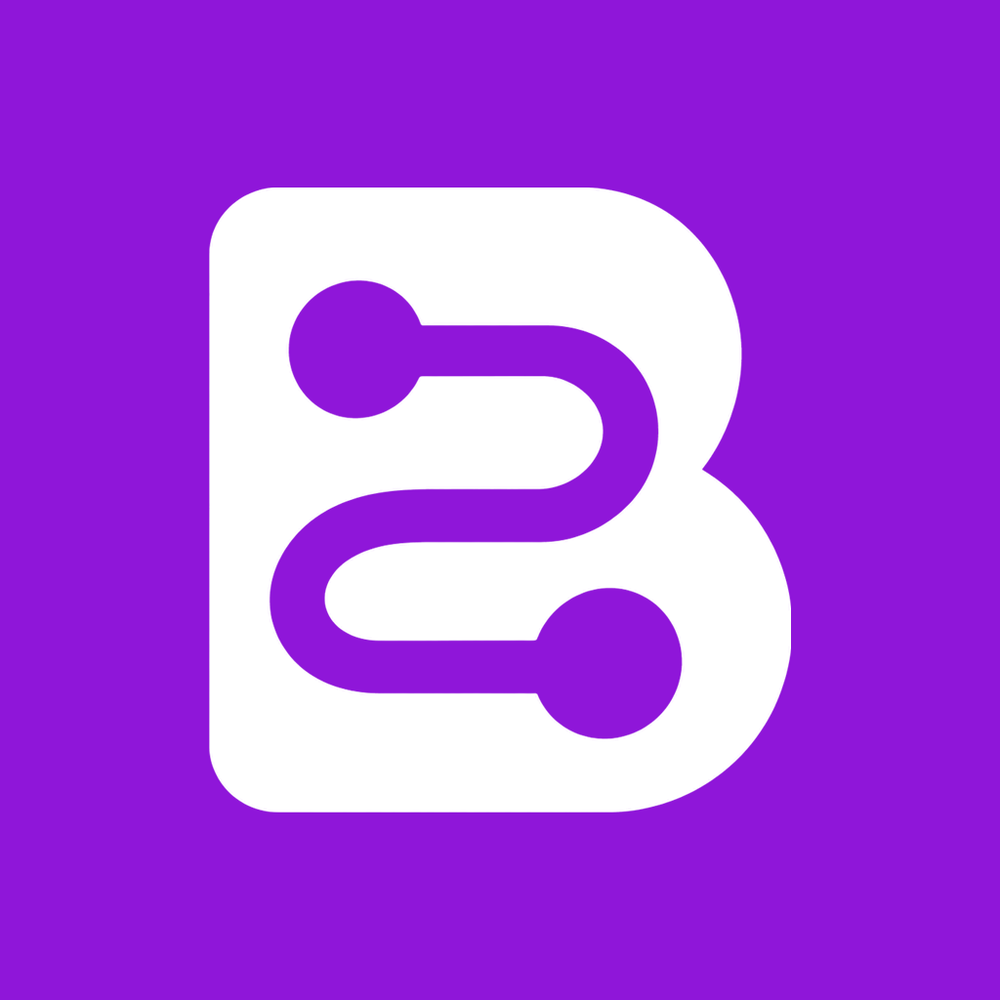
  <h1>BuscaEu</h1>
  
<strong>Mobilidade compartilhada para universitários</strong>

  
Encontre, ofereça e organize caronas entre estudantes em um único aplicativo.

  
  
  
  
  
  

  
Projeto Final de Curso · UniSALESIANO · 2026

  
<a href="#sobre">Sobre</a> · <a href="#interface">Interface</a> · <a href="#funcionalidades">Funcionalidades</a> · <a href="#arquitetura">Arquitetura</a> · <a href="#qualidade-e-testes">Testes</a> · <a href="#autores">Autores</a>

> **Showcase público:** este repositório apresenta o produto e seus aspectos técnicos. O código-fonte, as configurações de execução e os dados da aplicação não fazem parte deste repositório.

## Sobre

O deslocamento universitário pode envolver longas distâncias, custos de transporte e horários incompatíveis com o transporte coletivo. O BuscaEu foi desenvolvido para facilitar a organização de caronas entre estudantes com trajetos compatíveis, centralizando ofertas, reservas, pontos de embarque, comunicação e acompanhamento das viagens.

Uma mesma conta pode atuar como motorista ou passageiro. A solução foi concluída no escopo acadêmico, com aplicativo móvel, API própria, banco relacional em nuvem e integrações externas.

## Interface

Capturas reais do aplicativo móvel, extraídas dos anexos do relatório técnico v0.8 (novembro de 2026).

<table>
<tr>
<td align="center">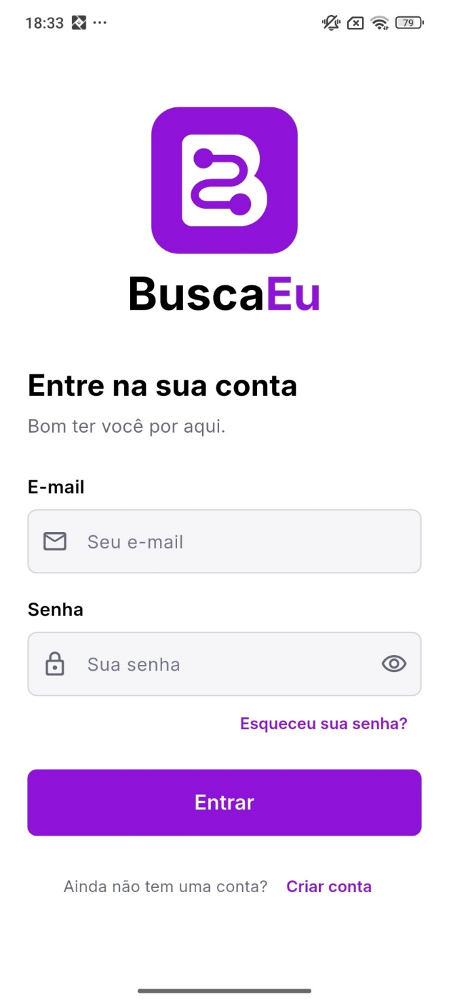</td>
<td align="center">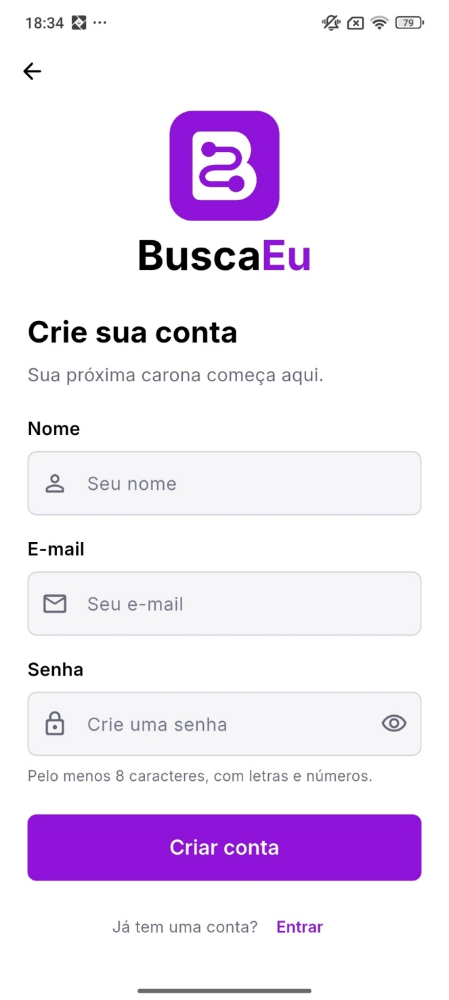</td>
<td align="center">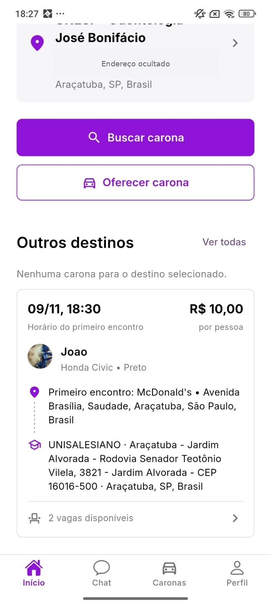</td>
<td align="center">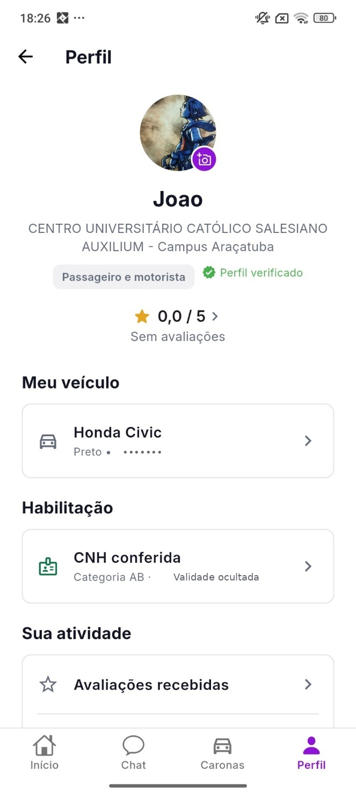</td>
<td align="center">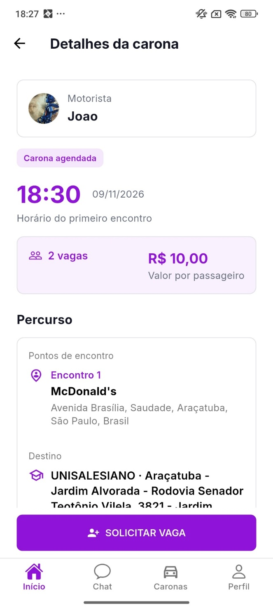</td>
</tr>
<tr>
<td align="center">Login</td>
<td align="center">Cadastro</td>
<td align="center">Início</td>
<td align="center">Perfil</td>
<td align="center">Detalhes</td>
</tr>
</table>

<table>
<tr>
<td align="center">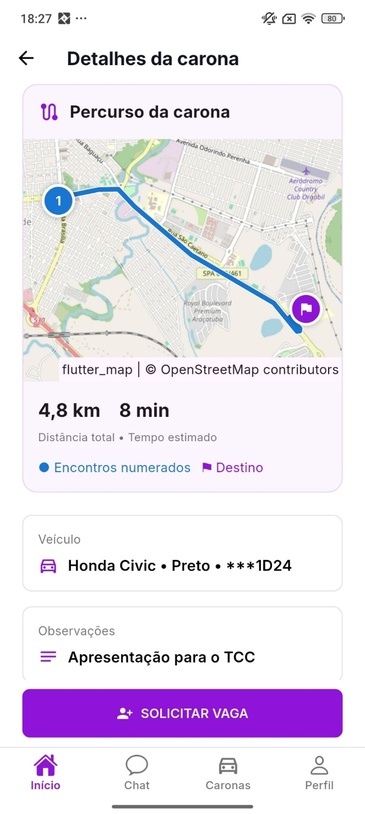</td>
<td align="center">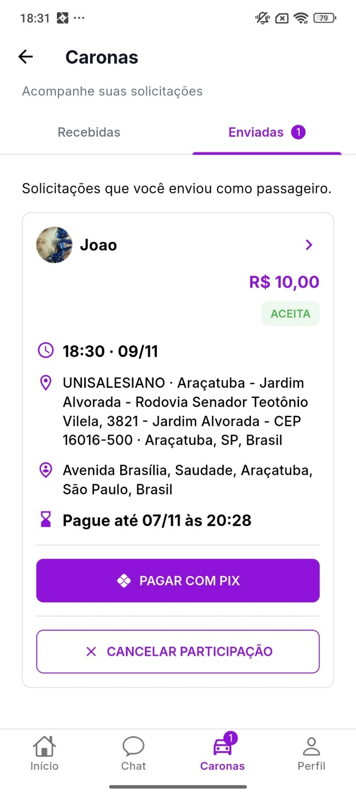</td>
<td align="center">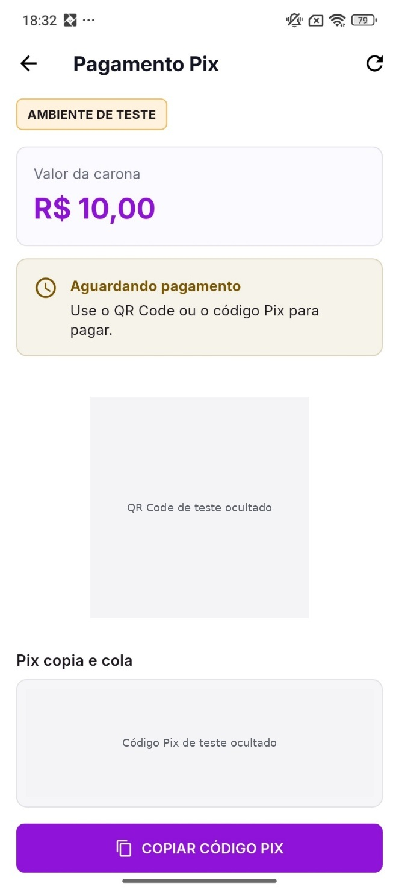</td>
<td align="center">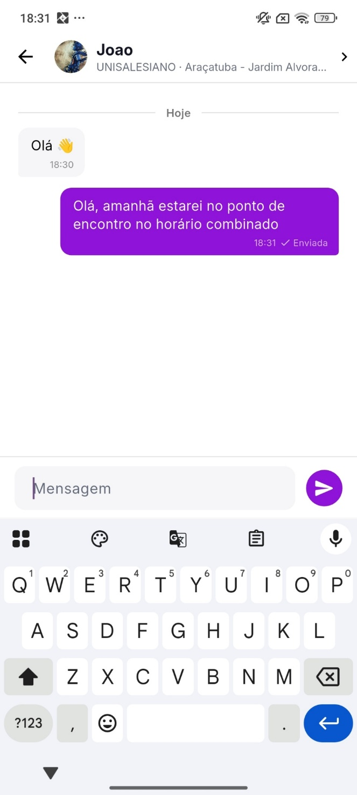</td>
<td align="center">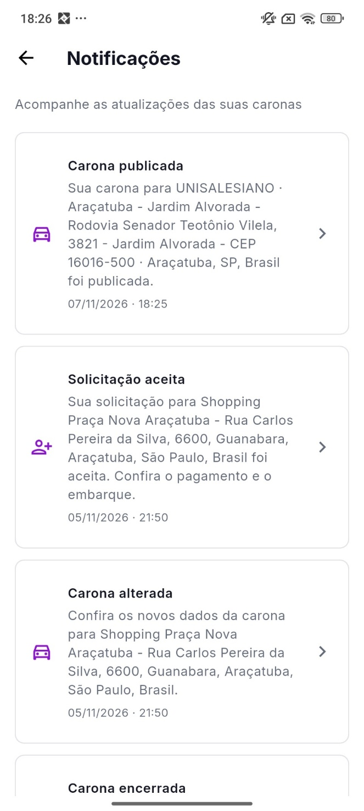</td>
</tr>
<tr>
<td align="center">Percurso</td>
<td align="center">Solicitação</td>
<td align="center">Pix de teste</td>
<td align="center">Chat</td>
<td align="center">Notificações</td>
</tr>
</table>

*Algumas informações de identificação e os códigos de pagamento de teste foram ocultados para publicação.*

A identidade visual utiliza o roxo `#8F16D9`, tipografia Inter e componentes reutilizáveis.

## Funcionalidades

| Área | Recursos |
| --- | --- |
| Acesso e perfil | Cadastro, confirmação de e-mail, recuperação de senha, instituição, campus e foto de perfil. |
| Motorista | Cadastro e edição de veículo; conferência interna dos dados da CNH por OCR no dispositivo. |
| Caronas | Publicação, pesquisa por destino e data, edição, cancelamento e pontos de embarque. |
| Recorrências | Programações por período e dias da semana, com geração de viagens independentes, pausa e retomada. |
| Reservas | Solicitação de vaga, escolha ou sugestão de ponto de encontro, aceite, recusa e controle da disponibilidade. |
| Mapas e percurso | Pesquisa de endereços, cálculo de rotas, localização GPS e acompanhamento da viagem pelo passageiro. |
| Comunicação | Chat entre participantes após o aceite, indicadores de leitura e central de notificações internas. |
| Pagamentos | Pix em ambiente de testes, QR Code, confirmação por webhook, expiração e registro de estorno simulado. |
| Histórico e reputação | Histórico das viagens, avaliação do motorista pelo passageiro e apresentação de média e quantidade de avaliações. |

### Jornada de uma carona

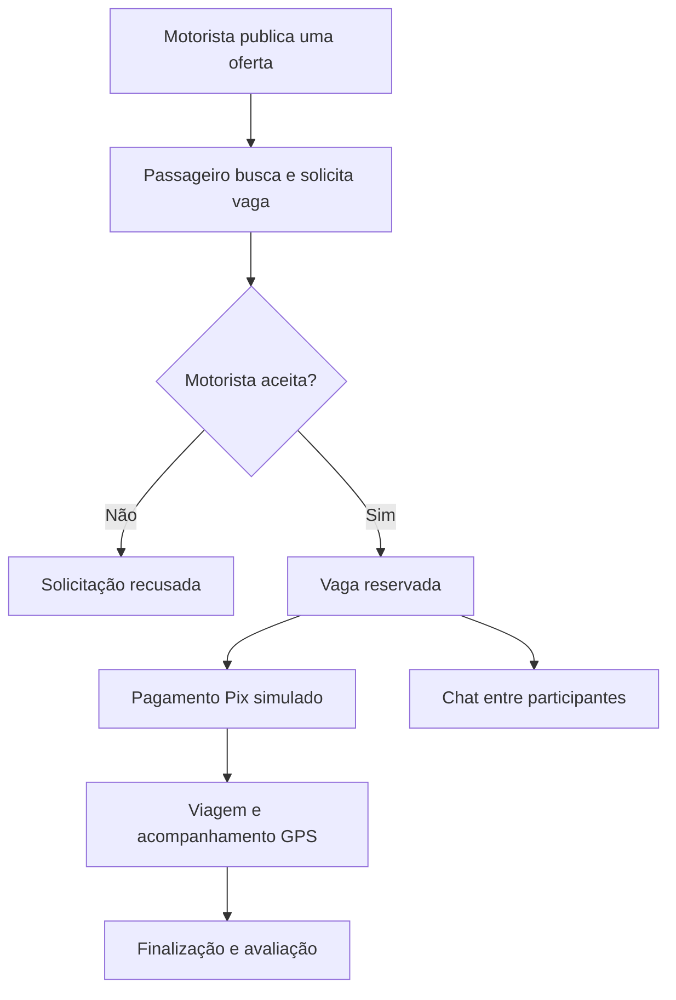

## Arquitetura

O BuscaEu utiliza uma arquitetura cliente-servidor com três componentes principais: aplicativo Flutter, API REST modular em NestJS e PostgreSQL gerenciado pelo Supabase.

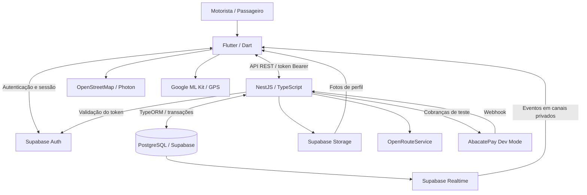

A API concentra as regras de negócio e a autorização sobre recursos. Controllers recebem requisições, Guards validam a identidade, Services executam operações e repositórios TypeORM acessam o banco. Funções e gatilhos PostgreSQL complementam a lógica da aplicação.

### Tecnologias e integrações

| Camada | Tecnologias |
| --- | --- |
| Mobile | Flutter, Dart, flutter_map, geolocator, Google ML Kit |
| Backend | Node.js, TypeScript, NestJS, Express, TypeORM |
| Banco e serviços | PostgreSQL, Supabase Auth, Storage e Realtime |
| Mapas | OpenStreetMap, Photon, OpenRouteService |
| Pagamentos | AbacatePay API v2 (Dev Mode) |
| Infraestrutura declarada no relatório técnico | Render e Resend |
| Qualidade e versionamento | Jest, Supertest, Flutter Test, Git e GitHub Actions |

## Destaques de engenharia

- **Consistência das reservas:** transações e bloqueios de registros para evitar conflitos na disponibilidade de vagas.
- **Processamento idempotente:** identificação única de eventos de webhook e verificação da cobrança junto ao provedor.
- **Recorrências:** geração de ocorrências independentes, com restrições contra duplicação.
- **Privacidade:** OCR da CNH no dispositivo, sem persistência da fotografia do documento.
- **Comunicação:** canais privados do Supabase Realtime e autorização vinculada à participação.
- **Percurso:** compartilhamento da posição atual, filtragem de leituras GPS e controle do progresso da viagem.
- **Histórico:** preservação dos dados do veículo associados à oferta publicada.
- **Reputação:** agregação de média e quantidade de avaliações para exibição nos cards.

A documentação acadêmica inclui requisitos funcionais e não funcionais, regras de negócio, modelagem de dados com 16 tabelas de domínio e diagramas C4.

## Qualidade e testes

Resultados registrados pela equipe na regressão de **08/11/2026**:

| Verificação | Resultado registrado |
| --- | --- |
| Backend — Jest | 799 testes aprovados em 53 suítes |
| Mobile — Flutter Test | 2.165 testes aprovados |
| Compilação NestJS | Aprovada |
| Análise estática Flutter | Nenhum problema relatado |

Também foram registradas verificações em dispositivo Android em **07/11/2026**, incluindo reconhecimento local de texto, câmera e localização. Parte dos testes utiliza dependências simuladas e dados sintéticos.

Os números correspondem a execuções históricas documentadas pela equipe; não representam uma garantia de cobertura integral, ausência de falhas ou homologação comercial.

## Limites do escopo acadêmico

- A integração Pix utiliza exclusivamente o ambiente de desenvolvimento da AbacatePay, sem dinheiro real. Estornos simulados são registros locais; não há saque, split ou repasse financeiro.
- A conferência da CNH verifica a consistência dos dados extraídos por OCR, sem validação oficial perante órgãos de trânsito.
- O acompanhamento GPS depende das permissões, da conectividade e do aplicativo em uso.
- O BuscaEu não é apresentado como serviço comercial em operação.

Este showcase não disponibiliza APK, vídeo integral ou acesso ao código-fonte. As imagens e a documentação de apresentação são mantidas neste repositório, independentemente do repositório de implementação.

## Autores

| Desenvolvedor | |
| --- | --- |
| Henrique Ortiz Martins | Coautor |
| João Pedro Ferreira Martins | Coautor |

**Orientador:** Renato de Aguiar Teixeira Mendes  
**Coorientador:** Francisco Antonio de Souza

Centro Universitário Católico Salesiano Auxilium — UniSALESIANO  
Tecnologia em Desenvolvimento de Sistemas · Araçatuba/SP · 2026
